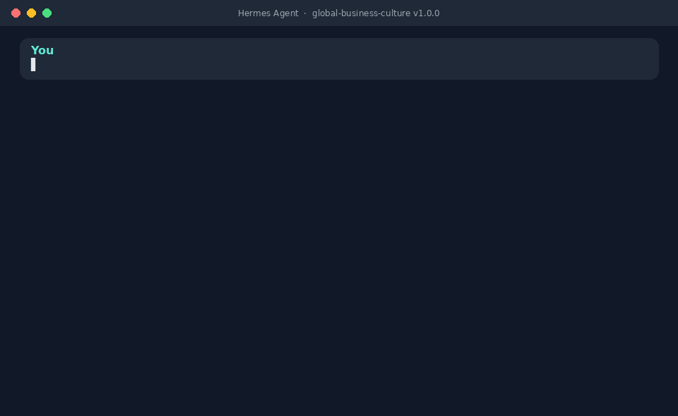

# global-business-culture (Hermes plugin)

Cross-cultural business intelligence for Hermes Agent: **country culture briefs** and
**home-vs-host gap analysis** computed deterministically from bundled research data —
Meyer (The Culture Map, 8 scales), Hofstede (6 dimensions), GLOBE clusters and the
Lewis model — plus practitioner field notes, including deep ASEAN/frontier-market
coverage (Laos, Cambodia, Myanmar).

This is data + arithmetic, not prompt text: the gap analysis ranks the exact scale
distances between two cultures, names the misread each gap produces, and prescribes
adaptation moves — the same inputs, every time, fully offline.

## See it in action



*Condensed replay of real `culture_gap_analysis` output (Laos → Australia, negotiation).*

## Try these prompts

Install, then paste any of these into Hermes. Each one triggers a real tool call
(the tool and task are shown so you can see what runs).

**1. Studying in Australia** — `culture_gap_analysis` · Laos → Australia · *email/communication*

> I'm a Lao professional applying for a master's scholarship in Australia. I need to
> email a potential supervisor and then do a video interview with the admissions panel
> next week. How will my communication style be read, and what should I change?

**2. Inviting Australian mining companies to Laos** — `culture_gap_analysis` · Laos → Australia · *first meeting*

> My team is inviting Australian mining companies to visit Laos and explore copper,
> gold and potash opportunities. We've never hosted Australian mining executives.
> How will they expect the first meeting to run, and what are they likely to misread about us?

**3. Cross-border trading partnership** — `culture_gap_analysis` · Laos → Australia · *negotiation*

> I run a Lao coffee export company and want to sign a distribution partnership with an
> Australian importer. Prepare me for the negotiation: where will our styles clash on
> trust, disagreement and deadlines, and how do I adapt?

Swap in any of the 57 supported economies (try Thailand, China, Vietnam, Japan), or use
`/culture Australia first meeting` for an instant one-country brief.

## Tools

| Tool | What it does |
|---|---|
| `culture_brief(country, task?)` | Structured brief: positioning, trust currency, decision path, communication, contract treatment, etiquette, taboos, country highlights, task-specific advice. |
| `culture_gap_analysis(home_country, host_country, task?)` | Ranked cultural distance: 8 Meyer scale gaps (delta, risk level, task-weighted), misread risk + adaptation per gap, Hofstede flags ≥25, synthesis. |
| `culture_countries(query?)` | Coverage list / search. 57 economies. |

Also registers:

- `/culture <country> [task]` — instant in-session brief
- skill `global-business-culture:business-culture-playbook` — practitioner playbook
  (stalled-deal diagnosis, first-visit sequencing, within-country calibration,
  frontier-market overlay)

Common aliases resolve: USA, UK, UAE, Korea, Holland, Czech Republic, Burma, Lao PDR,
PRC, HK, KSA, RSA, Türkiye…

## Install

```bash
hermes plugins install pswong661-eng/hermes-global-business-culture
```

Or drop the repo into `~/.hermes/plugins/global-business-culture` and restart.

## Design guarantees

- **Offline & deterministic**: no network calls, no env vars, no Python
  dependencies beyond the standard library, no filesystem writes. Enterprise-safe.
- **Never raises**: every handler returns JSON — success or structured error with
  suggestions.
- **Honest data**: scale positions are approximations distilled from the published
  frameworks; countries not in the original datasets (Laos, Cambodia, Myanmar) are
  extrapolated from GLOBE-cluster neighbours and flagged `extrapolated` in output.
  Cultural data is directional orientation, not measurement; verify time-sensitive
  facts (holidays, visa rules) separately.

## Test

```bash
python -m pytest tests/ -q
hermes plugins doctor . --ci
```

## Data provenance & license

Scale positions distilled from Erin Meyer, *The Culture Map* (PublicAffairs, 2014);
Geert Hofstede Insights country scores; GLOBE leadership clusters; Richard Lewis
culture-type model — encoded as approximate positions by the authors. Practitioner
notes from field work in Southeast Asian and frontier markets.

MIT © Eric Wong (pswong661-eng)
